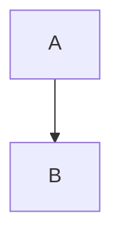

# Foreign fences

```text
hello
```

Text after a named fence.

```cola
a:
    x: 1
;
```

```
unnamed fence
```



```toml
[table]
key = "value"
```

```cola
b:
    y: 2
;
```

```text
looks plural like:
    cola: 1
;
```

```cola
c:
    z: 3
;
```
